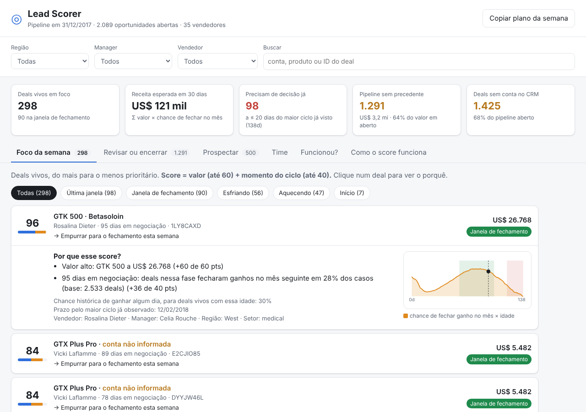

# Submissão — Felipe Holanda — Challenge 003

## Sobre mim

- **Nome:** Felipe Holanda
- **LinkedIn:** [linkedin.com/in/felipe-holandadev](https://www.linkedin.com/in/felipe-holandadev/)
- **Challenge escolhido:** 003 — Lead Scorer (Vendas / RevOps)

---

## Executive Summary

Construí o **Lead Scorer**, um painel que o vendedor abre na segunda-feira e vê quais deals empurrar, por quê e o que fazer com cada um
(abre com duplo clique: `solution/app/index.html`). Antes de pontuar, testei as features "óbvias": **vendedor, produto, setor, conta e região
não preveem se um deal fecha** (p-valores de 0,26 a 0,97; um modelo de ML com tudo teve AUC 0,49, igual a um chute). O que os dados preveem é
*quando* um deal fecha. Por isso o score combina **valor (60 pts)** com **momento do ciclo (40 pts)**. Em backtest em 9 segundas-feiras
passadas, o top 10 de cada vendedor capturou **47% da receita ganha no mês seguinte** (vs 41% ordenando por valor e 18% aleatório),
com ~50% mais acerto. O achado mais importante para a Head de RevOps: **64% do valor em aberto (US$ 3,2 mi) está em deals mais velhos
que qualquer deal que já fechou na empresa**. O forecast está inflado, e a primeira ação recomendada é limpar esses deals.

---

## Solução

### Abordagem

1. **Dados antes de código.** Corrigi o que quebraria um join silenciosamente (`GTXPro` ≠ `GTX Pro`, 17% dos deals sem preço)
   e mapeei o que falta (68% do pipeline aberto sem conta).
2. **Testar o sinal antes de dar peso.** Qui-quadrado para cada feature, curva de sobrevivência do ciclo e backtest temporal sem vazamento.
   O resultado mudou a pergunta: de "vai fechar?" (sem sinal) para **"o que fecha ganho nos próximos 30 dias e quanto vale?"** (com sinal).
3. **Score simples, explicável e validado.** Uma curva empírica (com correção de censura) + valor em escala log. A mesma função
   roda no backtest e na interface.
4. **Produto para não-técnico.** Filas com ação clara, frase de "por quê" em cada deal, filtros, visão do manager e plano da semana em texto.

### Resultados / Findings

**A ferramenta** ([setup, lógica e limitações](solution/README.md))

| Aba | O que responde |
|---|---|
| Foco da semana | Deals vivos ordenados por score, com fase (Início, Aquecendo, Janela de fechamento, Esfriando, Última janela) e ação |
| Revisar ou encerrar | 1.291 deals sem precedente, ordenados por valor: "confirme se existe ou encerre" |
| Prospectar | 500 prospects por valor |
| Time | Receita esperada, deals vivos e pipeline sujo por vendedor, manager e região |
| Como o score funciona | A curva, a fórmula, o backtest e o que o score não faz, para o vendedor confiar |

**Validação (código de produção, 9 segundas-feiras de abr a nov/2017)**

| Ordenação | Receita ganha no mês que estava no top 10 de cada vendedor | Top 10 que virou Won no mês |
|---|---|---|
| **Lead Scorer** | **47%** | **23%** |
| Só valor | 41% | 15% |
| Aleatório | 18% | 16% |

**Findings sobre o pipeline (31/12/2017)**

- **Pipeline fantasma:** 1.291 de 1.589 deals em Engaging (US$ 3,2 mi, 64% do valor aberto) são mais velhos que o maior ciclo da história (138 dias).
- **O ciclo tem duas ondas:** metade dos perdidos morre em até 14 dias; os ganhos se concentram entre ~60 e ~100 dias (pico em 85).
  Depois disso, a chance cai toda semana.
- **Região Central sem receita no horizonte:** 5 deals vivos, US$ 0 esperado em 30 dias, e todos os 500 prospects (US$ 1,07 mi) parados lá.
- **14 de 35 vendedores sem nenhum deal vivo**, incluindo 3 que fecharam entre 123 e 275 deals no ano e estão com a carteira zerada.
- **Sem sinal:** vendedor, produto, setor, conta, região, manager. Diferenças de win rate entre eles cabem no ruído.

### Recomendações

1. **Esta semana:** cada vendedor trabalha o próprio "Foco da semana" (top 10) e dedica 1 hora à fila "Revisar ou encerrar", começando
   pelos deals maiores. Meta: zerar os deals sem precedente em 4 semanas, para o forecast passar a refletir o pipeline real.
2. **Managers da Central:** a conversa não é priorização, é converter os 500 prospects em engajamento. A região não tem receita esperada
   para janeiro.
3. **Regra de CRM:** conta obrigatória ao criar oportunidade (hoje 68% dos abertos estão sem) e alerta automático quando um deal passa de 120 dias.
4. **Próximo passo de dados:** registrar atividades (ligações, reuniões, e-mails) e motivo de perda. É o que falta para prever *se* um deal
   fecha, não só *quando*. Qualquer novo componente do score só entra se bater o backtest atual.

### Limitações

- O score responde "quando" e "quanto", não "se": o dataset não tem sinal para isso (sem atividades, sem motivo de perda).
- Dataset sintético: padrões que pareciam artefatos (pico de vitórias no fim de trimestre, nenhum deal fechando no trimestre de início) ficaram fora do score.
- A fila "Revisar" não distingue deal morto de deal com data errada no CRM: por isso a ação é verificar.
- "Hoje" é o último dia dos dados (31/12/2017). Em produção, um job diário leria o CRM e regeraria `data.js`.
- Detalhes e caminho para escalar em [`solution/README.md`](solution/README.md#limitações).

---

## Process Log — Como usei IA

> Narrativa completa, erros e scripts em [`process-log/`](process-log/README.md).

### Ferramentas usadas

| Ferramenta | Para que usou |
|------------|--------------|
| Claude Code | Agente que rodou toda a análise em Python real, os testes estatísticos, os backtests, o código do scorer, a interface, os testes e a documentação |
| pandas, scipy, scikit-learn | Exploração, χ², e o gradient boosting usado como "o que um baseline faria" |
| Playwright + Chromium | Screenshots e verificação da interface (erros de console, layout mobile) |
| pytest | 9 testes que travam as regras críticas do score |

### Workflow

1. Leitura do brief e escolha do 003; download dos dados da fonte original (Kaggle bloqueada no ambiente).
2. Primeira olhada: qualidade e chaves (`01_first_look`).
3. Teste de sinal de cada feature antes de dar peso (`02_signal_tests`).
4. Backtest de "vai fechar?": AUC ≈ 0,5 para tudo. A pergunta mudou (`03_backtest`).
5. Comparação de 6 ordenações por receita capturada; escolha do 60/40 aditivo por explicabilidade (`04_score_design`).
6. Scorer em Python + backtest usando a mesma função; correção de censura na curva.
7. Interface HTML/JS, testada com Playwright em desktop e mobile.
8. Testes, documentação e este log.

### Onde a IA errou e como corrigi

- **Viés de censura:** a primeira curva ignorava deals que continuam abertos e dizia que deals com 127 dias tinham 78% de chance de fechar
  no mês (o real é 5%). O painel teria mandado o vendedor gastar a semana em deals morrendo. Corrigido com a lógica de Kaplan-Meier.
- **Backtest otimista:** o primeiro teste mostrava 69% de receita capturada porque só olhava deals com desfecho conhecido. O backtest
  do código de produção, honesto, dá 47%.
- **Limiar fixo de fase** quebrou depois da correção da curva; virou relativo ao pico.
- Erros menores de compatibilidade (pandas, JSON) e uma frase exagerada na interface ("pior que o chute" quando era igual ao chute).

### O que eu adicionei que a IA sozinha não faria

Escolhi o 003 porque é o desafio em que o entregável é software rodando, e também onde é mais fácil entregar algo que só parece bom: qualquer IA monta um score com pesos para vendedor, setor e porte da conta, e o resultado convence. Minha principal decisão foi sobre como usar a IA. Em vez de colar o brief num chat e aceitar a resposta, trabalhei com um agente (Claude Code) que roda código de verdade, com uma regra: nada entra no score sem teste estatístico e sem backtest. Foi essa regra que derrubou o score óbvio (ele acerta o mesmo que um chute) e mudou a pergunta de "esse deal vai fechar?" para "o que fecha no próximo mês e quanto vale?". O mesmo rigor pegou o erro mais perigoso do processo: a primeira versão dizia que deals com 127 dias tinham 78% de chance de fechar no mês, quando o número real é 5%. O que mais me chamou atenção nos achados não foi o ranking, foi o estado do pipeline: 64% do valor em aberto está em deals mais velhos do que qualquer deal que já fechou, e a região Central não tem receita esperada para o mês seguinte. Se eu fosse a Head de RevOps, é isso que eu ia querer saber antes de qualquer score. Com mais tempo, eu faria duas coisas diferentes: conversaria com dois ou três vendedores antes de desenhar a interface, para confirmar que as filas e as ações batem com a rotina deles, e buscaria dados de atividade do CRM (ligações, reuniões, motivo de perda), que é o que falta para prever *se* um deal fecha, e não só *quando*.

---

## Evidências

- [x] Screenshots da ferramenta: [`process-log/screenshots/`](process-log/screenshots/)
- [x] Scripts de análise com as saídas: [`process-log/analysis/`](process-log/analysis/)
- [x] Git history (commits por etapa nesta branch)
- [x] Testes automatizados: [`solution/tests/`](solution/tests/)

---

_Submissão enviada em: 22/10/2026_
